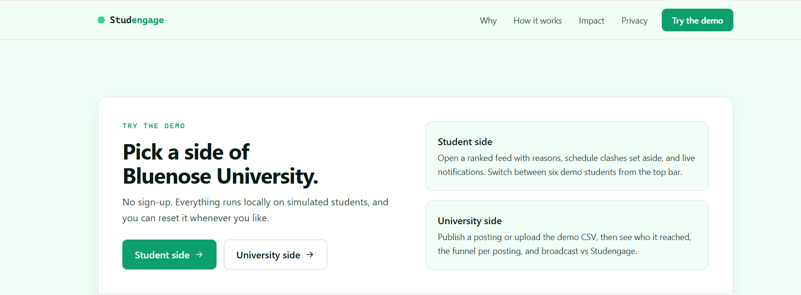
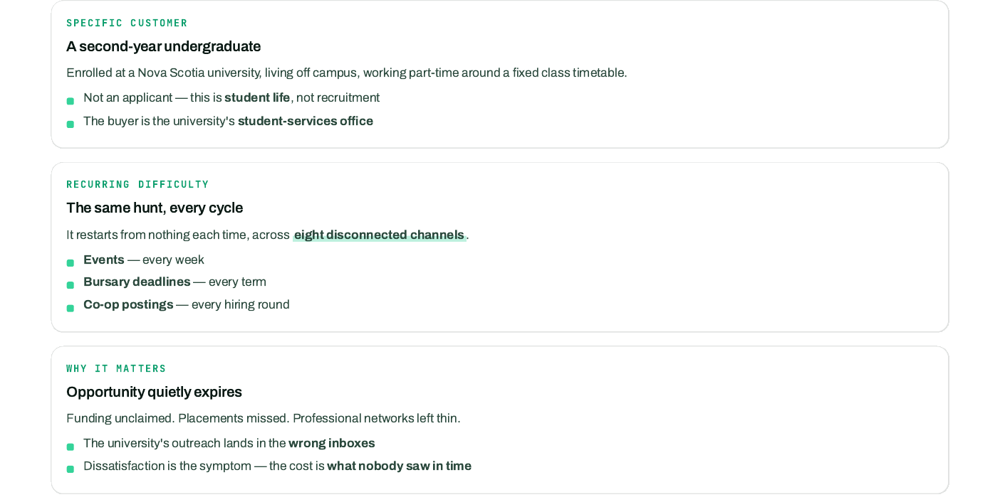
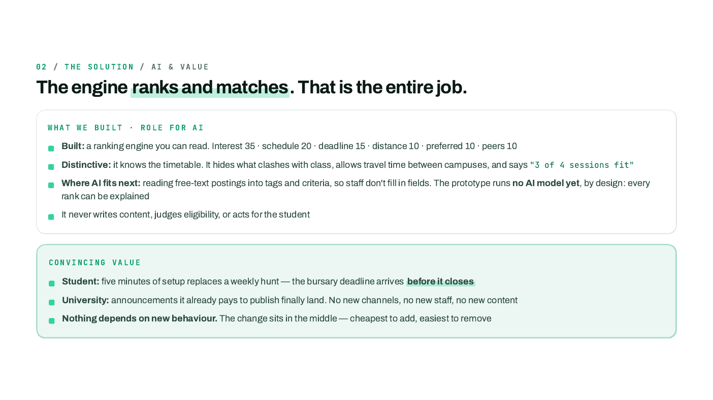
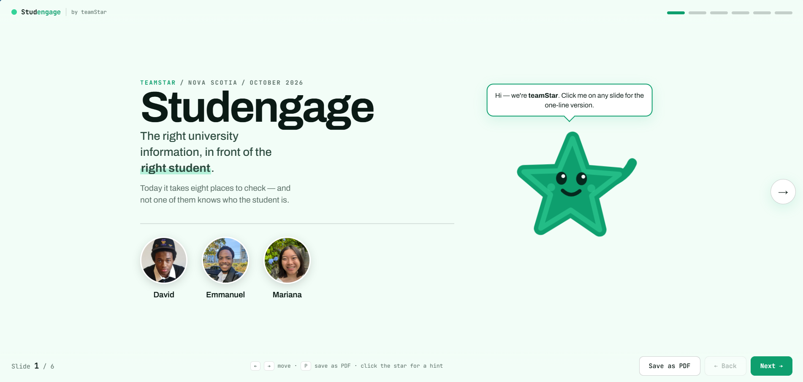

# 🌟 Studengage

### The right university information, in front of the right student.

**A hackathon prototype for discovering campus events, bursaries, and co-op opportunities — without searching every university channel.**

*The demo's entry screen: explore the same university postings from a student's or a university's perspective.*

[**The problem**](#the-problem) · [**Our solution**](#our-solution) · [**How it works**](#how-it-works) · [**Project visuals**](#project-visuals) · [**Team**](#team)

---

## 💡 The problem

Campus opportunities are often scattered across **emails, portals, department pages, and other communication channels**. Students may miss a bursary deadline, a networking event, or a co-op posting simply because they didn't see the right announcement in time.

Our hackathon challenge was not to invent more announcements. It was to **make existing announcements easier for the right students to discover**.

*An excerpt from our hackathon pitch: three ways missed information impacts students.*

## 🚀 Our solution

**Studengage** matches university announcements with individual students based on their self-declared profile and schedule. Students receive a shorter, more relevant feed; university staff can publish opportunities and review their **simulated** reach.

| 🎓 Student experience | 🏫 University experience |
| :--- | :--- |
| Personalized feed of opportunities | Create posts or import a demo CSV |
| Recommendations with clear reasons | Reach students whose profiles match |
| Class-schedule conflict checks | Review engagement and reach in the demo |
| Deadlines and limited notifications | Compare targeted delivery with broad announcements |
| Interest-based feedback | Keep content under university control |

## 🔄 How it works

1. **Publish:** University staff add events, bursaries, and co-op opportunities using a form or CSV upload.
2. **Set preferences:** Students enter their program, year, campus, interests, and available times.
3. **Filter and rank:** The engine considers matching criteria and conflicts with classes, then ranks the remaining opportunities.
4. **Explain:** The student sees a focused feed, including why an opportunity appears and any relevant deadlines.
5. **Act:** Students follow the posting to the university's own page to apply or participate.
6. **Refine:** Interest and participation feedback can adjust future rankings.

## 🛠️ What we built

- A **transparent matching and ranking engine** that considers interests, timetable availability, deadlines, and other criteria.
- **Schedule-aware recommendations**, including checks for class conflicts.
- **Explainable recommendation cards** showing why opportunities are relevant.
- A **student-side demo** with selectable student personas and a ranked feed.
- A **university-side demo** for creating posts, uploading a CSV, and inspecting simulated outcomes.
- An **impact comparison** that contrasts broad announcements with personalized recommendations in the simulation.

> **Technical note:** The hackathon prototype uses an explainable, **rule-based scoring formula — not a running AI model**. A possible next step is AI-assisted extraction of tags and criteria from free-text university announcements.

## 🖼️ Project visuals

### Behind the matching

*Our pitch explained what the ranking engine currently does and where AI could help in a future version.*

### Presentation and demo

📄 **[View the full hackathon pitch deck (PDF)](docs/pitch-deck.pdf)**

> The website screenshot above shows the **demo landing page**, not the student feed or university dashboard. Those views would be useful additions once separate screenshots are available.

## 🧪 Prototype scope

The prototype was demonstrated using **Bluenose University**, a fictional campus, with **256 simulated students** (six sample personas and 250 generated profiles). No real student login or data is required for the demonstration.

The team's pitch proposed a **30% improvement in relevant reach** as a goal for a future pilot — **not** as a measured real-world result. The simulation is intended to explore the approach, not establish actual student outcomes.

## 🔮 What's next?

- Explore AI-assisted interpretation of university announcements.
- Test usability and recommendation relevance with consenting students and university staff.
- Evaluate real-world reach and missed-opportunity rates against an agreed baseline.
- Review accessibility, privacy, and institutional integration before a live pilot.

## 👥 Team

Built collaboratively during a **2026 hackathon** by:

- **David**
- **Emmanuel**
- **Mariana**

The project was designed, discussed, developed, and tested together, **largely using one computer**. Team members can be linked to their GitHub profiles here once their usernames are available.

---

**Studengage** · A hackathon prototype, not a live university service.

Test with real students and university staff, with appropriate consent and privacy review.

Evaluate whether personalized delivery improves the reach of relevant announcements.

Studengage is a hackathon prototype, not a production university service.
